# 🚀 Assistente de Investimentos com RPA e IA Generativa (n8n + Python)

<p align="center">
  
  
  
  
  
  
</p>

Pipeline completo de automação inteligente de ponta a ponta: extração automatizada de clientes via **RPA (Python/BeautifulSoup)**, orquestração de workflow com cruzamento de dados financeiros e catálogo de investimentos no **n8n**, geração de recomendações personalizadas com **IA Generativa (OpenAI / Gemini)** e disparo automatizado de e-mails via **Gmail**.

---

## 🌟 Novidades e Características Desta Nova Atualização

Esta versão eleva o projeto do desafio inicial da DIO para uma **solução corporativa completa**, robusta e 100% alinhada com a arquitetura apresentada na aula prática:

### 1. 🏗️ Arquitetura n8n 100% Fiel ao Canvas Oficial (10 Nós)
- **Fluxo Completo Integrado**: O workflow principal agora espelha exatamente a esteira ensinada na aula:
  $$\text{Webhook} \rightarrow \text{HTTP Request} \rightarrow \text{Parse CSV} \rightarrow \text{Merge} \rightarrow \text{Normalização} \rightarrow \text{Cruzamento e Prompts} \rightarrow \text{LLM IA} \rightarrow \text{Formatação} \rightarrow \text{Validação If} \rightarrow \text{Gmail} \rightarrow \text{Respond Webhook}$$
- **Separação de Itens por Cliente**: O nó de JavaScript processa o payload em lote e o converte em itens independentes, permitindo que a IA gere recomendações individualizadas para cada cliente.

### 2. 🛡️ Resiliência com Fallback Inteligente (Zero Bloqueio)
- **Execução Sem Travamentos**: O nó de IA (`Message a model`) conta com tratamento de erro (`continueRegularOutput`) e mecanismo de fallback inteligente.
- **Modo Offline/Sem Créditos**: Se você ainda não configurou ou não possui créditos na OpenAI/Gemini, o sistema **não quebra**: ele ativa um gerador automático de mensagens baseado em regras financeiras e templates elegantes.

### 3. 🤖 Suporte Duplo a Modelos de IA Generativa
- **`workflow.json` (OpenAI / GPT-4o-mini)**: Modelo rápido, econômico e refinado com prompt de consultor de investimentos sênior.
- **`workflow_ia.json` (Google Gemini via LangChain)**: Alternativa 100% gratuita utilizando a API do Google AI Studio com o nó nativo do Gemini no n8n.

### 4. 🐍 Script RPA Python Turbinado com CLI
- **Interface de Linha de Comando (`rpa/extrair_clientes.py`)**: Suporte a argumentos via `argparse`:
  - `--webhook`: Envia diretamente para o endpoint do n8n.
  - `--local`: Permite raspar o arquivo local `docs/index.html` (ideal para desenvolvimento sem internet).
  - `--url`: Personaliza a URL alvo do scraping.
  - `--csv-url`: Permite enviar uma URL alternativa para a base de investimentos.
- **Tabela Formatada no Terminal**: Exibe o resumo dos clientes coletados e a resposta detalhada retornada pelo n8n.
- **Notebook Interativo Atualizado (`rpa/extrair_clientes.ipynb`)**: Pronto para rodar no Google Colab ou Jupyter com envio direto via Webhook.

### 5. ✉️ Disparo Automatizado e Validação de E-mails
- **Nó Condicional (`If`)**: Valida se o cliente possui um endereço de e-mail válido antes de tentar o disparo.
- **Integração com Gmail**: Dispara automaticamente a recomendação de investimentos como e-mail formatado para a caixa postal do cliente.

### 6. 📊 Regras Financeiras e Cruzamento Inteligente de Portfólio
- **Filtro por Saldo e Perfil**: O algoritmo analisa o perfil de risco (*Conservador*, *Moderado*, *Arrojado*) e cruza com os valores mínimos de aporte do catálogo (`docs/data.csv`), recomendando apenas ativos viáveis ao bolso do cliente.

---

## 📊 Comparativo: Versão Base DIO vs. Nova Atualização

| Recurso / Funcionalidade | Versão Inicial Base | Nova Atualização (Esta Versão) |
|---|:---:|:---:|
| **Orquestração n8n** | Estrutura básica conceitual | **10 nós interligados** no padrão oficial da aula |
| **Integração de E-mail** | Não contemplada | **Nó Gmail + Validação com Nó If** |
| **Tratamento de Falhas na IA** | Erro interrompia o fluxo | **Fallback automático** sem travar o pipeline |
| **Modelos de IA Suportados** | Apenas menção teórica | **OpenAI (GPT-4o-mini)** e **Google Gemini** |
| **Script RPA** | Notebook com `TODO` manual | **Script CLI Python** + **Notebook** configurados |
| **Execução Offline/Local** | Apenas página online | Suporte a **`--local docs/index.html`** |
| **Documentação Técnica** | Genérica | **README dedicado em `n8n/`** com Docker e cURL |

---

## 📐 Arquitetura do Pipeline

O fluxo funciona de forma contínua e assíncrona entre o robô de extração, a esteira do n8n e os serviços externos:

```mermaid
flowchart LR
    subgraph RPA["1. RPA (Python)"]
        WEB["Página Web / Local<br>(docs/index.html)"] --> SCRAPE["extrair_clientes.py<br>(BeautifulSoup)"]
    end

    subgraph N8N["2. Orquestração no n8n"]
        WH["📡 Webhook<br>(POST /clientes)"]
        HTTP["🌐 HTTP Request<br>(GET data.csv)"]
        PARSE["⚙️ Parse CSV<br>(Investimentos)"]
        MERGE["🔀 Merge<br>(Combine)"]
        NORM["⚙️ Normalizar<br>(Clientes + CSV)"]
        CRUZ["⚙️ Cruzar Dados<br>(Perfil x Saldo)"]
        AI["🧠 Message a Model<br>(GPT-4o / Gemini)"]
        FMT["⚙️ Formatar Email<br>(Corpo e Assunto)"]
        COND["🔀 If<br>(Email Válido?)"]
        RESP["📤 Respond to Webhook<br>(HTTP 200)"]

        WH --> HTTP --> PARSE --> MERGE
        WH --> MERGE
        MERGE --> NORM --> CRUZ --> AI --> FMT --> COND
        COND -->|Sim| MAIL["✉️ Gmail<br>(Send message)"]
        COND -->|Não / Final| RESP
        MAIL --> RESP
    end

    subgraph OUT["3. Destinatários"]
        CL["Inbox dos Clientes<br>(Recomendações Personalizadas)"]
    end

    SCRAPE -->|POST JSON| WH
    MAIL --> CL

    classDef rpaStyle fill:#e8f5e9,stroke:#2e7d32,stroke-width:2px;
    classDef n8nStyle fill:#fff3e0,stroke:#e65100,stroke-width:2px;
    classDef aiStyle fill:#f3e5f5,stroke:#7b1fa2,stroke-width:2px;
    classDef outStyle fill:#e1f5fe,stroke:#0288d1,stroke-width:2px;

    class WEB,SCRAPE rpaStyle;
    class WH,HTTP,PARSE,MERGE,NORM,CRUZ,FMT,COND,RESP n8nStyle;
    class AI aiStyle;
    class MAIL,CL outStyle;
```



---

## 🛠️ Tecnologias Utilizadas

- **Linguagem & RPA**: Python 3.10+, BeautifulSoup4, Urllib, Requests, Argparse.
- **Orquestração de Workflows**: [n8n](https://n8n.io/) (versão Community/Cloud ou Docker).
- **Inteligência Artificial Generativa**:
  - OpenAI API (`gpt-4o-mini`) via nó nativo `Message a model`.
  - Google Gemini API (`gemini-1.5-flash / gemini-pro`) via nó nativo LangChain no n8n.
- **Disparo de Mensagens**: Google Gmail API / SMTP.
- **Frontend / Simulação de Dados**: HTML5, CSS3, CSV estruturado no GitHub Pages.

---

## 📁 Estrutura do Repositório

```text
📁 Desafio Dio-assistente-investimentos-rpa-n8n/
├── 📄 README.md                    # Este arquivo com visão geral e novidades
├── 📁 rpa/                         # Módulo de Automação Robótica de Processos
│   ├── 📄 extrair_clientes.py      # Script executável via linha de comando com CLI
│   └── 📄 extrair_clientes.ipynb   # Notebook interativo (Google Colab / Jupyter)
├── 📁 n8n/                         # Módulo de Workflows e Orquestração
│   ├── 📄 workflow.json            # Workflow oficial da aula (OpenAI + Fallback + Gmail)
│   ├── 📄 workflow_ia.json         # Workflow avançado com Google Gemini e LangChain
│   └── 📄 README.md                # Guia minucioso de importação, nós e testes no n8n
└── 📁 docs/                        # Ambiente de Simulação Web e Catálogo
    ├── 📄 index.html               # Página com a tabela de clientes fictícios
    └── 📄 data.csv                 # Catálogo de ativos financeiros por perfil de risco
```

---

## 🚀 Guia de Início Rápido (Quickstart)

### 1. Iniciar o n8n

Você pode usar o [n8n Cloud](https://n8n.io) ou iniciar localmente via Docker ou npx:

```bash
# Opção 1: Via Docker
docker run -it --rm --name n8n -p 5678:5678 -v ~/.n8n:/home/node/.n8n n8nio/n8n

# Opção 2: Via npx
npx n8n
```

Acesse no navegador: `http://localhost:5678`.

### 2. Importar o Workflow no n8n

1. No n8n, clique no menu de opções no canto superior direito (`...`) e selecione **Import from File...**.
2. Selecione o arquivo [`n8n/workflow.json`](n8n/workflow.json) (ou [`n8n/workflow_ia.json`](n8n/workflow_ia.json)).
3. Abra o nó **Webhook**, copie a **Test URL** (ex: `http://localhost:5678/webhook-test/clientes`).
4. Clique no botão **"Listen for test event"** para aguardar a requisição do robô.

### 3. Executar o Script RPA em Python

Instale as dependências:
```bash
pip install beautifulsoup4 requests
```

Execute a extração e o envio automático para o n8n:
```bash
# Envio para o webhook de teste do n8n
python rpa/extrair_clientes.py --webhook "http://localhost:5678/webhook-test/clientes"

# Ou usando o arquivo HTML localmente:
python rpa/extrair_clientes.py --local --webhook "http://localhost:5678/webhook-test/clientes"
```

O script exibirá a lista de clientes capturados e enviará o payload JSON ao n8n em segundos!

---

## 💬 Exemplo de Recomendação Gerada

### Entrada (Dados do Cliente):
```json
{
  "nome": "Ana Silva",
  "email": "ana@email.com",
  "saldo": "R$ 12.500,00",
  "perfil": "Conservador"
}
```

### Saída Gerada pela IA (Corpo do E-mail):
> **Assunto:** *Recomendações exclusivas de investimentos para Ana*
>
> Olá, **Ana**! Espero que esteja tendo uma excelente semana.
>
> Analisando o seu perfil de investidora **Conservadora** e o seu saldo disponível de **R$ 12.500,00**, selecionamos oportunidades sob medida focadas em alta liquidez e proteção patrimonial:
>
> • **CDB Liquidez Diária** | Aporte Mínimo: R$ 1.000,00 | Rentabilidade: 12.5% a.a.  
> • **Tesouro Selic** | Aporte Mínimo: R$ 500,00 | Rentabilidade: 13.0% a.a.  
> • **Poupança** | Aporte Mínimo: R$ 100,00 | Rentabilidade: 6.2% a.a.  
>
> Como seu objetivo prioriza a segurança, o **Tesouro Selic** e o **CDB** são ideais para rentabilizar acima da inflação mantendo a disponibilidade para resgates quando necessário.
>
> Gostaria de dar início a essa alocação hoje mesmo? Nossa equipe de assessoria está à sua total disposição!

---

## 🎓 Entregáveis do Desafio DIO

- [x] **Repositório Estruturado**: Código fonte versionado e limpo.
- [x] **Script de RPA Funcional**: Extração HTML com BeautifulSoup via CLI e Notebook.
- [x] **Workflow Principal n8n (`workflow.json`)**: Com 10 nós, cruzamento de dados, filtros financeiros e fallback.
- [x] **Workflow com Agente de IA Generativa (`workflow_ia.json`)**: Integração completa com LLMs.
- [x] **Disparo e Validação de E-mails**: Nó de decisão `If` e nó `Gmail`.
- [x] **Documentação Técnica Completa**: Guias passo a passo em `README.md` e `n8n/README.md`.

---

## 🤝 Créditos e Agradecimentos

Projeto desenvolvido como parte do desafio da plataforma [Digital Innovation One (DIO)](https://www.dio.me/). Aprimorado com funcionalidades avançadas de IA, automação e arquitetura corporativa.
