# 🤖 Workflows n8n - Assistente de Investimentos com RPA e IA

Este diretório contém os workflows prontos para importação no **n8n**, responsáveis por orquestrar a lógica de negócio do Assistente de Investimentos: receber os clientes extraídos pelo RPA, obter o catálogo de investimentos, cruzar as informações por perfil e saldo, e gerar recomendações personalizadas (tanto via regras/templates quanto via Inteligência Artificial Generativa).

---

## 📁 Arquivos Disponíveis

| Arquivo | Descrição | Requisitos de Chaves |
|---|---|---|
| [`workflow.json`](./workflow.json) | **Workflow Principal (MVP)**: Processamento completo com cruzamento de dados, filtros financeiros e templates inteligentes por perfil. | **Nenhum** (pronto para execução imediata). |
| [`workflow_ia.json`](./workflow_ia.json) | **Workflow Avançado (Desafio com IA)**: Integração com **LangChain LLM Chain** e **Google Gemini** para redação de mensagens hiperpersonalizadas e humanizadas. | Chave de API do Google Gemini (ou OpenAI). |

---

## 🏗️ Como Funciona o Pipeline no n8n (Arquitetura Oficial da Aula)

```mermaid
flowchart LR
    W["📡 Webhook<br>(POST /clientes)"] --> H["🌐 HTTP Request<br>(GET data.csv)"]
    W --> M["🔀 Merge<br>(combine)"]
    H --> C0["⚙️ Code in JavaScript<br>(Parse CSV)"]
    C0 --> M
    M --> C1["⚙️ Code in JavaScript1<br>(Normalizar Dados)"]
    C1 --> C2["⚙️ Code in JavaScript2<br>(Cruzar Clientes x Investimentos)"]
    C2 --> AI["🧠 Message a model<br>(OpenAI / LLM)"]
    AI --> C3["⚙️ Code in JavaScript3<br>(Formatar Email/Mensagem)"]
    C3 --> IF["🔀 If<br>(Validar Email)"]
    IF -->|true| G["✉️ Send a message<br>(Gmail)"]
    G --> R["📤 Respond to Webhook<br>(HTTP 200)"]

    style W fill:#e1f5fe,stroke:#0288d1,stroke-width:2px;
    style H fill:#fff3e0,stroke:#f57c00,stroke-width:2px;
    style C0 fill:#f3e5f5,stroke:#7b1fa2,stroke-width:2px;
    style M fill:#e8eaf6,stroke:#3f51b5,stroke-width:2px;
    style C1 fill:#f3e5f5,stroke:#7b1fa2,stroke-width:2px;
    style C2 fill:#f3e5f5,stroke:#7b1fa2,stroke-width:2px;
    style AI fill:#e8f5e9,stroke:#2e7d32,stroke-width:2px;
    style C3 fill:#f3e5f5,stroke:#7b1fa2,stroke-width:2px;
    style IF fill:#fff8e1,stroke:#f57f17,stroke-width:2px;
    style G fill:#fce4ec,stroke:#c2185b,stroke-width:2px;
    style R fill:#e0f2f1,stroke:#00796b,stroke-width:2px;
```



### Detalhamento dos Nós (Idêntico ao Canvas da Aula):

1. **Webhook (`Webhook`)**:
   - Escuta requisições `POST` no endpoint.
   - Envia os dados simultaneamente para a requisição de investimentos e para o `Merge`.

2. **HTTP Request (`HTTP Request`)**:
   - Faz o download do catálogo de investimentos `data.csv`.
   - Permite usar a URL padrão ou uma URL customizada passada pelo Python (`$json.body.csv_url`).

3. **Code in JavaScript (`Code in JavaScript`)**:
   - Realiza o parse das linhas do CSV em uma lista de objetos estruturados com produtos, aporte mínimo e rentabilidade.

4. **Merge (`Merge`)**:
   - Combina os clientes recebidos no Webhook (Input 1) com a lista de investimentos do CSV (Input 2).

5. **Code in JavaScript1 (`Code in JavaScript1`)**:
   - Valida e normaliza as estruturas dos dados combinados em um único pacote consolidado.

6. **Code in JavaScript2 (`Code in JavaScript2`)**:
   - Cruza cada cliente com os investimentos adequados ao seu perfil e saldo financeiro.
   - Converte o pacote em 10 itens individuais e prepara o prompt contextualizado para a IA.

7. **Message a model (`Message a model`)**:
   - Gera as mensagens de recomendação hiperpersonalizadas via LLM com base no perfil e saldo do investidor.

8. **Code in JavaScript3 (`Code in JavaScript3`)**:
   - Formata o assunto e corpo final do e-mail/mensagem para cada cliente e valida o destinatário.

9. **If (`If`)**:
   - Verifica se o cliente possui um endereço de e-mail válido para envio.

10. **Send a message (`Send a message - Gmail`)**:
    - Dispara o e-mail personalizado para a caixa postal do cliente.

11. **Respond to Webhook (`Respond to Webhook`)**:
    - Retorna a confirmação e o relatório com os clientes processados e suas recomendações.

5. **Consolidar Resultados (`n8n-nodes-base.code`)**:
   - Reúne todos os clientes processados em um objeto consolidado com contadores, timestamp e status de sucesso.

6. **Resposta Webhook (`n8n-nodes-base.respondToWebhook`)**:
   - Emite resposta HTTP 200 com `Content-Type: application/json` contendo o relatório final.

---

## 🚀 Passo a Passo: Como Importar e Usar no n8n

### Passo 1: Abrir sua Instância do n8n
- Você pode usar o **n8n Cloud** (gratuito para teste em [n8n.io](https://n8n.io)) ou rodar localmente com Docker:
  ```bash
  docker run -it --rm --name n8n -p 5678:5678 -v ~/.n8n:/home/node/.n8n n8nio/n8n
  ```
  Ou via npx:
  ```bash
  npx n8n
  ```
- Acesse `http://localhost:5678` no seu navegador.

### Passo 2: Importar o Workflow
1. No menu superior direito do canvas do n8n, clique no menu de três pontinhos `...` ou aperte `Ctrl + O`.
2. Selecione **Import from File...** e escolha o arquivo [`workflow.json`](./workflow.json).
   - *(Alternativa: Abra o arquivo `.json` em um editor, copie o texto e cole diretamente na tela do n8n com `Ctrl + V`).*
3. O fluxo completo com todos os nós interligados aparecerá na tela.

### Passo 3: Ativar o Webhook para Teste
1. Dê um duplo clique no nó **Webhook Clientes**.
2. Você verá duas URLs:
   - **Test URL:** `http://localhost:5678/webhook-test/clientes`
   - **Production URL:** `http://localhost:5678/webhook/clientes`
3. Para testar interativamente, clique no botão **"Test step"** ou **"Listen for test event"** na parte superior da tela do n8n.

### Passo 4: Disparar o Envio pelo RPA
No terminal do seu projeto, execute o script RPA passando a URL copiada do n8n:

```bash
python rpa/extrair_clientes.py --webhook "http://localhost:5678/webhook-test/clientes"
```

Se estiver usando o Google Colab ou o Jupyter Notebook [`rpa/extrair_clientes.ipynb`](../rpa/extrair_clientes.ipynb), basta descomentar a célula do TODO:
```python
N8N_WEBHOOK = "http://localhost:5678/webhook-test/clientes"
requests.post(N8N_WEBHOOK, json={"clientes": clientes})
```

---

## 🧪 Testando com cURL ou Postman

Você também pode testar o webhook diretamente sem rodar o Python:

```bash
curl -X POST "http://localhost:5678/webhook-test/clientes" \
  -H "Content-Type: application/json" \
  -d '{
    "clientes": [
      {
        "nome": "Ana Silva",
        "email": "ana@email.com",
        "saldo": "R$ 12.500,00",
        "perfil": "Conservador"
      },
      {
        "nome": "Carla Souza",
        "email": "carla@email.com",
        "saldo": "R$ 28.900,00",
        "perfil": "Arrojado"
      }
    ]
  }'
```

---

## 🔮 Desafio Extra: Usando o `workflow_ia.json` (Google Gemini)

Caso deseje entregar o **Desafio Completo com IA Generativa**:

1. Importe o arquivo [`workflow_ia.json`](./workflow_ia.json) no n8n.
2. Dê duplo clique no nó **Google Gemini Chat Model**.
3. Em **Credential for Google Gemini**, clique em **Create New Credential**.
4. Cole sua chave gratuita da API do Gemini (obtida no [Google AI Studio](https://aistudio.google.com/app/apikey)).
5. Salve a credencial e clique em **Listen for test event**.
6. Ao disparar os clientes, o nó LLM do n8n gerará textos únicos e humanizados para cada cliente!
